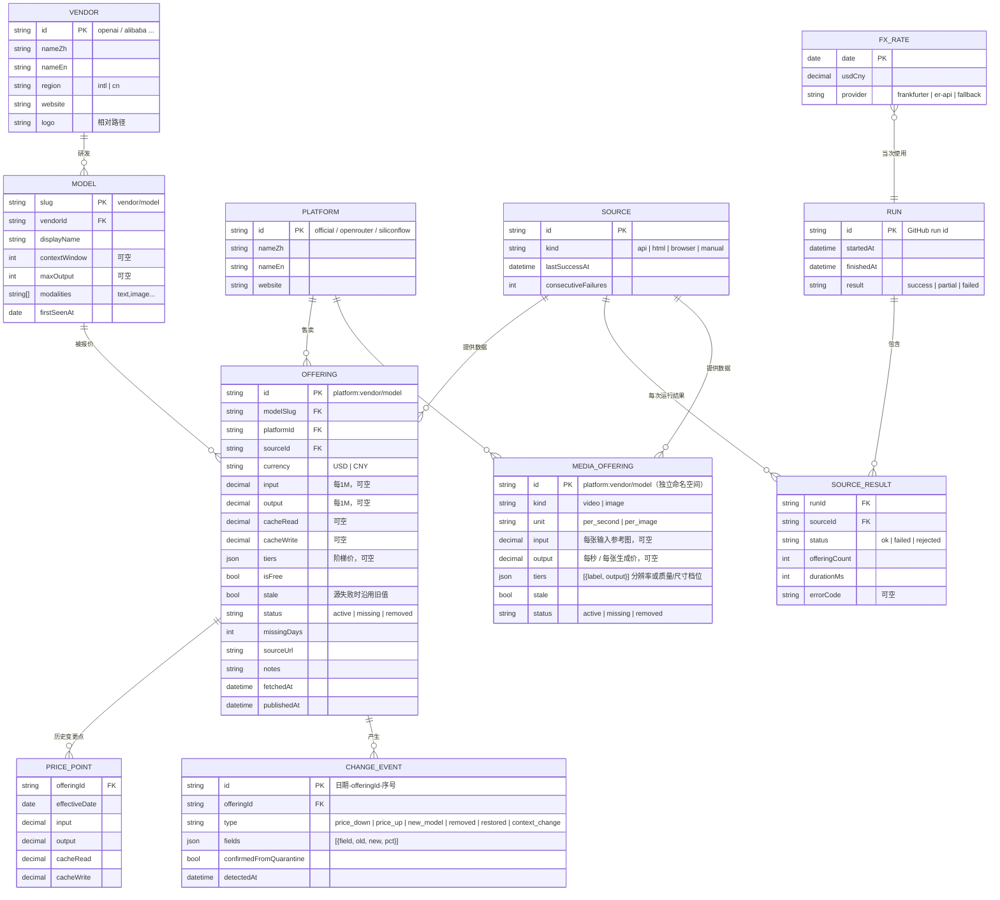
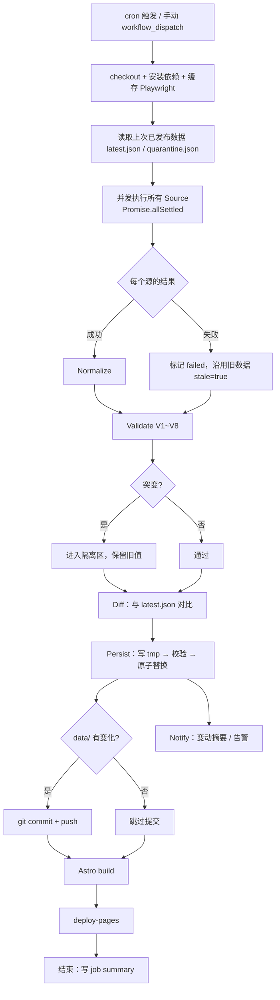
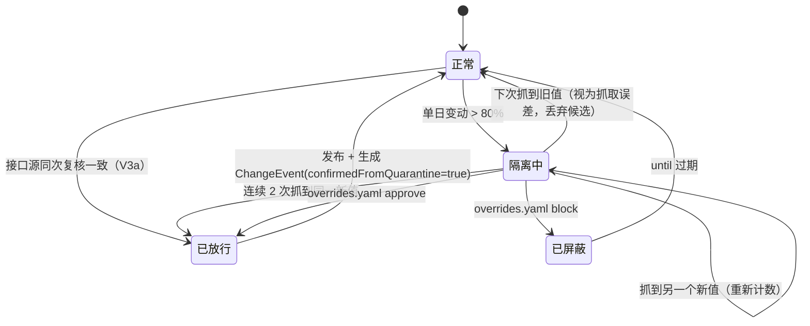
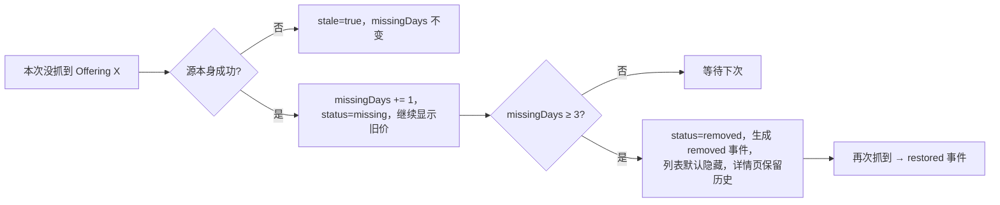
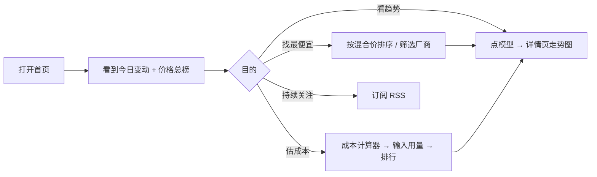
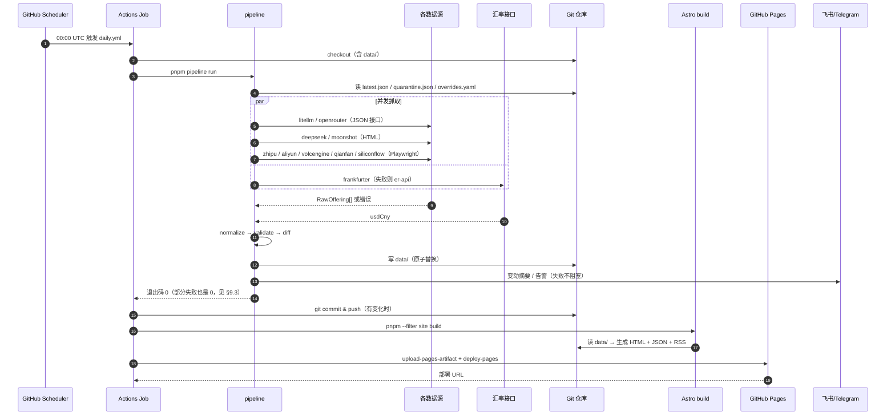
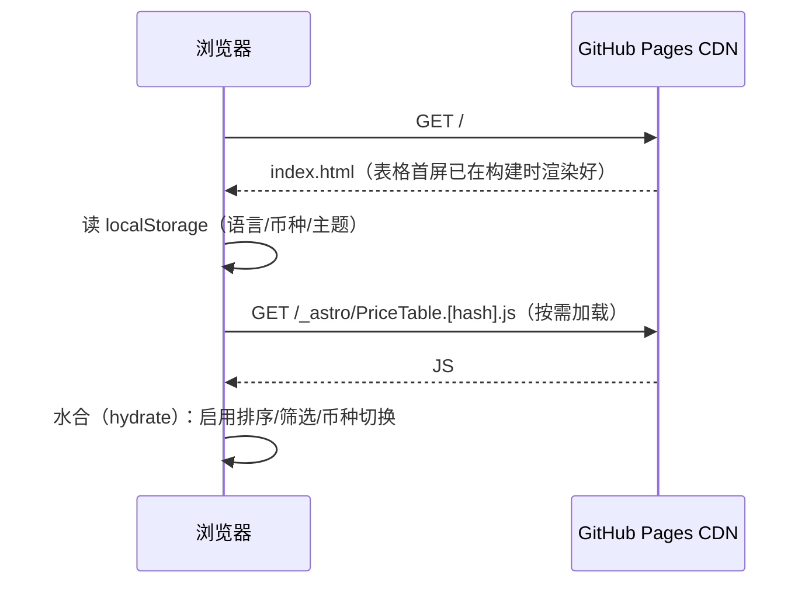

# AI API 价格榜 · 开发文档（DEV_DOCUMENT）

| 项       | 内容                                                                 |
| -------- | -------------------------------------------------------------------- |
| 文档版本 | v1.1（新增视频/图像生成模型，§3.13）                                 |
| 创建日期 | 2026-10-18                                                           |
| 状态     | 规划已确认，待开发                                                   |
| 配套文档 | `AI_API_价格榜_API.md`（数据接口）· `AI_API_价格榜_STYLE.md`（规范） |

> 目标读者：任何接手本项目的开发者。读完本文档，应能不问任何问题直接继续开发。

---

## 目录

1. [项目概述](#1-项目概述)
2. [系统架构](#2-系统架构)
3. [模块设计](#3-模块设计)
4. [数据模型（ER 图）](#4-数据模型er-图)
5. [核心业务流程](#5-核心业务流程)
6. [时序图](#6-时序图)
7. [环境变量](#7-环境变量)
8. [第三方服务配置指南](#8-第三方服务配置指南)
9. [错误码对照表](#9-错误码对照表)
10. [性能预期与基准](#10-性能预期与基准)
11. [安全检查清单](#11-安全检查清单)
12. [测试策略](#12-测试策略)
13. [开发节点记录](#13-开发节点记录)
14. [问题汇总](#14-问题汇总)
15. [风险与应对](#15-风险与应对)

---

## 1. 项目概述

### 1.1 一句话定位

每天自动抓取全球主流 AI 模型 API 的最新价格，发布成一个免费托管、中英双语的比价网站。网站提供对比表、价格历史、成本计算器和变动提醒。

### 1.2 目标

| #   | 目标             | 衡量标准                                                   |
| --- | ---------------- | ---------------------------------------------------------- |
| G1  | 数据每日自动更新 | 每天北京时间 08:00 前后完成，无需人工                      |
| G2  | 覆盖面广         | 第一版 ≥ 15 个厂商/平台，≥ 300 个模型报价                  |
| G3  | 数据可信         | 疑似抓错的数据不上线；每条报价标注来源和抓取时间           |
| G4  | 零运维成本       | 不需要服务器，GitHub 免费额度内运行                        |
| G5  | 好用             | 首屏 < 1.5s，手机和电脑都能用，中英文切换，美元/人民币切换 |

### 1.3 非目标（第一版不做）

- 用户注册登录、评论、收藏（纯静态站，没有后端）
- 模型能力评测/跑分（只做价格，最多附上下文长度等基础参数）
- 图片/语音/视频模型的复杂计费（第一版只做**文本 LLM 的 token 计费**；Embedding 作为 P2）
  - **1.1 起**：视频（按秒）和图像（按张）生成模型单独收录，见 §3.13。仍然不做：语音、按 token 计价的图像输出、按分辨率 × 时长的组合计费、OpenRouter 的视频报价
- 实时价格（每天更新一次）

### 1.4 用户画像

| 用户      | 场景             | 最关心                               |
| --------- | ---------------- | ------------------------------------ |
| 开发者    | 选模型、估算成本 | 输入/输出/缓存价、上下文长度、计算器 |
| 产品/老板 | 对比国内外成本   | 人民币换算、最便宜排序               |
| 站长本人  | 维护数据         | 抓取失败告警、变动推送               |

### 1.5 数据覆盖（第一版）

| 类别             | 厂商/平台                                                                                           | 数据来源方式                                     |
| ---------------- | --------------------------------------------------------------------------------------------------- | ------------------------------------------------ |
| 国际主流         | OpenAI、Anthropic、Google Gemini、xAI、Mistral、Cohere、DeepSeek（国际站）                          | LiteLLM 开源价格库（主）+ OpenRouter（交叉核对） |
| 国内大厂         | DeepSeek、阿里通义（百炼）、智谱 GLM、月之暗面 Kimi、字节豆包（火山方舟）、百度文心（千帆）         | 官网定价页抓取                                   |
| 聚合平台         | OpenRouter、硅基流动 SiliconFlow                                                                    | OpenRouter 官方接口；硅基流动抓定价页            |
| 汇率             | USD ↔ CNY                                                                                           | Frankfurter（主）/ open.er-api.com（备）         |
| 视频/图像（1.1） | MiniMax、Google、xAI、OpenAI、阿里、字节、Runway、Black Forest Labs、Stability AI、Recraft（§3.13） | LiteLLM 开源价格库中厂商直连的条目               |

---

## 2. 系统架构

### 2.1 总体架构

```
┌──────────────────────────── GitHub 仓库 ─────────────────────────────┐
│                                                                       │
│  .github/workflows/daily.yml   cron: "0 0 * * *"（UTC 00:00 = 北京 08:00）│
│         │                                                             │
│         ▼                                                             │
│  ┌─────────────────────── pipeline（Node 24 + TS）───────────────────┐ │
│  │                                                                   │ │
│  │  ① Fetch     并发运行各 Source 抓取器（互相隔离，单个失败不影响全局）│ │
│  │     ├─ litellm      ├─ openrouter   ├─ fx（汇率）                  │ │
│  │     ├─ deepseek     ├─ aliyun       ├─ zhipu                      │ │
│  │     ├─ moonshot     ├─ volcengine   ├─ qianfan   ├─ siliconflow   │ │
│  │     └─ manual（手动兜底 YAML）                                     │ │
│  │                                                                   │ │
│  │  ② Normalize  统一单位（每百万 token）、统一模型 ID、币种换算       │ │
│  │  ③ Validate   Zod 结构校验 + 异常规则（突变/骤减/过期）→ 隔离区     │ │
│  │  ④ Diff       与上次已发布数据对比 → ChangeEvent 列表              │ │
│  │  ⑤ Persist    写 data/（latest / history / changes / status）      │ │
│  │  ⑥ Notify     飞书 / Telegram / 邮件（变动摘要 + 失败告警）        │ │
│  └───────────────────────────────────────────────────────────────────┘ │
│         │ git commit "chore(data): 2026-10-19 价格更新"                 │
│         ▼                                                             │
│  ┌─────────────────────── site（Astro 静态站）────────────────────────┐ │
│  │  读取 data/ → 生成 HTML 页面 + /api/v1/*.json + rss.xml             │ │
│  └───────────────────────────────────────────────────────────────────┘ │
│         │ actions/deploy-pages                                         │
└─────────┼─────────────────────────────────────────────────────────────┘
          ▼
   https://<用户名>.github.io/<仓库名>/   ←── 访客浏览器 / RSS 阅读器 / 调用 JSON 的程序
```

### 2.2 关键设计决策

| 决策                      | 选择                                                     | 理由                                                                               |
| ------------------------- | -------------------------------------------------------- | ---------------------------------------------------------------------------------- |
| 存储                      | Git 仓库内 JSON 文件，不用数据库                         | 零成本；Git 历史天然可追溯；静态站直接读                                           |
| 历史存储方式              | **变更点序列**（价格变了才追加一个点），不存每日全量快照 | 全量快照约 300KB/天、100MB+/年，会把仓库撑大；变更点序列一年也只有几百 KB          |
| 网站形态                  | 纯静态（SSG）                                            | GitHub Pages 只能托管静态文件；速度快、SEO 好                                      |
| 抓取与构建同一个 workflow | 是                                                       | `GITHUB_TOKEN` 推送的提交**不会触发**其他 workflow，所以分开写的话部署不会自动执行 |
| 语言                      | 全栈 TypeScript                                          | 抓取、校验 schema、前端共用一份类型定义                                            |
| 包管理                    | pnpm workspace（3 个包）                                 | `shared` 存类型/schema，`pipeline` 和 `site` 共同依赖它                            |

### 2.3 技术栈

| 层         | 技术                                        | 版本策略                            |
| ---------- | ------------------------------------------- | ----------------------------------- |
| 运行时     | Node.js 24 LTS（本地 ≥ 24 即可）            | `.nvmrc` = 24，`engines.node >= 24` |
| 包管理     | pnpm 9                                      | `packageManager` 字段锁定版本       |
| 语言       | TypeScript 5（strict）                      | —                                   |
| HTTP       | 原生 `fetch` + 自研重试封装                 | 无额外依赖                          |
| HTML 解析  | cheerio                                     | 用于服务端渲染的静态页面            |
| 浏览器渲染 | Playwright（仅 Chromium）                   | 仅用于 JS 渲染的定价页              |
| 校验       | Zod                                         | schema 放在 `shared` 包             |
| 网站框架   | Astro 7 + React 19（只用于交互组件）        | —                                   |
| 样式       | Tailwind CSS 4                              | 设计令牌见 STYLE §4                 |
| 图表       | uPlot                                       | 体积约 45KB，适合时间序列           |
| 测试       | Vitest（单元/集成）+ Playwright Test（E2E） | 覆盖率 ≥ 80%                        |
| 代码检查   | ESLint + Prettier + `tsc --noEmit`          | CI 必过                             |

### 2.4 目录结构

```
AI_API_价格榜/
├── .github/
│   └── workflows/
│       ├── daily.yml            # 每日：抓取 → 提交数据 → 构建 → 部署
│       └── ci.yml               # PR/推送：lint + 类型检查 + 测试 + 构建
├── packages/
│   ├── shared/                  # 共享类型 & Zod schema & 工具
│   │   └── src/
│   │       ├── schema.ts        # Offering / PricePoint / ChangeEvent ...
│   │       ├── units.ts         # 单位换算（per-token → per-1M）
│   │       └── slug.ts          # 模型 ID 规范化
│   ├── pipeline/                # 抓取管线
│   │   ├── src/
│   │   │   ├── index.ts         # CLI 入口：pnpm pipeline run
│   │   │   ├── core/
│   │   │   │   ├── http.ts      # fetch + 超时 + 重试 + 限速
│   │   │   │   ├── browser.ts   # Playwright 单例
│   │   │   │   ├── logger.ts
│   │   │   │   └── errors.ts    # PipelineError + 错误码
│   │   │   ├── sources/         # 每个数据源一个文件，实现 Source 接口
│   │   │   │   ├── litellm.ts
│   │   │   │   ├── litellm-media.ts  # LiteLLM 里的视频/图像生成条目
│   │   │   │   ├── openrouter.ts
│   │   │   │   ├── deepseek.ts
│   │   │   │   ├── aliyun.ts
│   │   │   │   ├── zhipu.ts
│   │   │   │   ├── moonshot.ts
│   │   │   │   ├── volcengine.ts
│   │   │   │   ├── qianfan.ts
│   │   │   │   ├── siliconflow.ts
│   │   │   │   ├── manual.ts
│   │   │   │   └── registry.ts  # 注册表：启用哪些源
│   │   │   ├── fx/              # 汇率
│   │   │   ├── steps/
│   │   │   │   ├── normalize.ts
│   │   │   │   ├── validate.ts
│   │   │   │   ├── diff.ts
│   │   │   │   ├── persist.ts
│   │   │   │   ├── media-normalize.ts  # 视频/图像的 V1/normalize/V2/V5
│   │   │   │   └── media-lane.ts       # 视频/图像的 reconcile/diff/history/落盘
│   │   │   └── notify/
│   │   │       ├── feishu.ts
│   │   │       ├── telegram.ts
│   │   │       ├── email.ts
│   │   │       └── index.ts
│   │   └── tests/
│   │       ├── fixtures/        # 各官网页面快照（HTML/JSON）
│   │       └── *.test.ts
│   └── site/                    # Astro 网站
│       ├── src/
│       │   ├── pages/
│       │   │   ├── index.astro              # 中文价格榜
│       │   │   ├── models/[vendor]/[model].astro
│       │   │   ├── calculator.astro
│       │   │   ├── changes.astro
│       │   │   ├── media.astro              # 视频/图像价格（1.1）
│       │   │   ├── about.astro
│       │   │   ├── en/...                   # 英文镜像路由
│       │   │   ├── api/v1/[...path].json.ts # 生成静态 JSON 接口
│       │   │   └── rss.xml.ts
│       │   ├── components/      # PriceTable / Calculator / PriceChart ...
│       │   ├── i18n/            # zh.json / en.json
│       │   ├── lib/             # 数据读取、格式化、换算
│       │   └── styles/
│       └── tests/e2e/
├── config/
│   ├── providers.yaml           # 厂商元数据（名称、官网、logo、地区）
│   ├── aliases.yaml             # 模型别名 → 规范 ID
│   ├── overrides.yaml           # 人工确认/强制放行/屏蔽
│   └── manual/                  # 手动兜底价格（抓不到的厂商）
│       └── <source>.yaml
├── data/                        # ⚠️ 由 pipeline 自动生成，人工勿改
│   ├── latest.json              # 当前已发布的全部报价
│   ├── history/<vendor>/<model>.json  # 每个模型的价格变更点序列
│   ├── changes/<YYYY-MM>.json   # 按月的变动事件
│   ├── quarantine.json          # 隔离区：疑似异常、待确认
│   ├── fx.json                  # 最近汇率 + 历史
│   ├── status.json              # 最近一次运行报告
│   └── media/                   # 视频/图像（1.1）：latest / quarantine / history / changes，结构同上
├── DEV_DOCUMENT.md
├── AI_API_价格榜_API.md
├── AI_API_价格榜_STYLE.md
├── .env.example
├── .nvmrc
├── package.json
└── pnpm-workspace.yaml
```

---

## 3. 模块设计

### 3.1 Source（抓取器）接口

每个数据源都实现同一个接口，管线不关心它内部是调接口还是抓网页。

```ts
// packages/pipeline/src/sources/types.ts
export interface Source {
  /** 唯一 ID，例如 "deepseek"、"openrouter" */
  readonly id: string;
  /** 这个源提供的报价属于哪个平台（官方直供 = 厂商自身） */
  readonly platform: PlatformId;
  /** 抓取方式，用于日志和超时策略 */
  readonly kind: "api" | "html" | "browser" | "manual";
  /** 单次抓取超时（毫秒） */
  readonly timeoutMs: number;
  /** 返回原始报价（尚未归一化）；失败时抛 PipelineError。1.1 起可以混有带 media 字段的视频/图像报价 */
  fetch(ctx: SourceContext): Promise<(RawOffering | RawMediaOffering)[]>;
}

export interface SourceContext {
  http: HttpClient; // 带重试和限速
  browser: () => Promise<BrowserPage>; // 懒加载 Playwright
  logger: Logger;
  now: Date;
}

export interface RawOffering {
  vendorHint: string; // 原始厂商名，如 "Anthropic"、"阿里云"
  modelName: string; // 原始模型名，如 "claude-sonnet-4-5"、"qwen-plus"
  currency: "USD" | "CNY";
  unit: "per_token" | "per_1k" | "per_1m"; // 原始计价单位
  input: number | null;
  output: number | null;
  cacheRead?: number | null;
  cacheWrite?: number | null;
  tiers?: RawTier[]; // 阶梯价（按上下文长度）
  contextWindow?: number | null;
  maxOutput?: number | null;
  sourceUrl: string; // 证据链接
  notes?: string; // 例如 "限时 5 折"、"夜间优惠"
}
```

**隔离原则**：管线用 `Promise.allSettled` 并发运行所有源。单个源超时或抛错，只会把该源标记为 `failed`，并沿用它上次的已发布数据（§3.6）。

### 3.2 数据源明细

> 节点 3 于 2026-10-18 实测。**重要**：开发机和 GitHub Actions 都在海外，阿里、Kimi、硅基流动、百度的国内站在海外无法连接（TCP 超时）。阿里改抓阿里云国际站的中文文档，只取其中的**「华北2（北京）」地域价**（国际站以美元标价，价格本身就是北京地域的国内价）；Kimi、硅基流动改抓国际站，价格为国际站美元价。国内站价格由 models.dev 补充（见下表）。如果需要人民币原价，见 §15 和 §14 #1。

| Source ID                  | 平台                               | 方式   | 实际入口                                                                                                                                                                            | 币种                        | 原始单位            | 模型数                     | 风险                                                                              |
| -------------------------- | ---------------------------------- | ------ | ----------------------------------------------------------------------------------------------------------------------------------------------------------------------------------- | --------------------------- | ------------------- | -------------------------- | --------------------------------------------------------------------------------- |
| `litellm`                  | 各国际厂商官方                     | api    | `https://raw.githubusercontent.com/BerriAI/litellm/main/model_prices_and_context_window.json`                                                                                       | USD                         | per_token           | 258（+ 视频 30 / 图像 36） | 低；社区维护，可能滞后 1~3 天                                                     |
| `openrouter`               | OpenRouter                         | api    | `https://openrouter.ai/api/v1/models`（公开，无需 Key）                                                                                                                             | USD                         | per_token（字符串） | 360（+ 视频 29）           | 低；分时段价格只记在 notes                                                        |
| `deepseek`                 | DeepSeek 官方                      | html   | `https://api-docs.deepseek.com/zh-cn/quick_start/pricing/`                                                                                                                          | CNY                         | per_1m              | 2                          | 中；表格行列转置，标准价 = 高峰价，错峰价写入 notes                               |
| `zhipu`                    | 智谱开放平台                       | html   | `https://docs.bigmodel.cn/cn/guide/start/pricing`（Mintlify 静态页）                                                                                                                | CNY                         | per_1m              | 32                         | 中；按输出长度分档的只取第一档，其余写入 notes                                    |
| `moonshot`                 | 月之暗面 Kimi                      | html   | 抓取 `https://platform.kimi.ai/docs/pricing/chat.md`，证据链接 `https://platform.moonshot.ai/docs/pricing/chat`                                                                     | **USD（国际站）**           | per_1m              | 4                          | 中；国内站海外不可达                                                              |
| `aliyun`                   | 阿里云百炼                         | html   | `https://www.alibabacloud.com/help/zh/model-studio/model-pricing`（国际站中文文档，只取「华北2（北京）」文本生成）                                                                  | **USD（北京地域价）**       | per_1m              | 64                         | 中；限时折扣取基础价，写入 notes                                                  |
| `volcengine`               | 火山方舟（豆包）                   | api    | 定价页 `https://www.volcengine.com/pricing?product=ark_bd&tab=1` 背后的公开匿名接口（GetNavigationV2 → ListTemplate → GetTable）                                                    | CNY                         | per_1k              | 8                          | 中；只收主力文本模型，32k/128k/256k 分档                                          |
| `siliconflow`              | 硅基流动                           | html   | `https://www.siliconflow.com/models`（国际站）                                                                                                                                      | **USD（国际站）**           | per_1m              | 53                         | 中；页面只列出约 79 个模型，不是完整目录                                          |
| `qianfan`                  | 百度千帆（文心）                   | —      | **已从注册表移除**                                                                                                                                                                  | —                           | —                   | 0                          | 海外无法访问任何百度定价页；需要国内网络人工核对后写 `config/manual/qianfan.yaml` |
| `modelsdev-cn`             | 官方（国内站）`official-cn`        | api    | `https://models.dev/api.json` 的 `moonshotai-cn` / `minimax-cn` / `stepfun`（MIT 社区数据库，github.com/anomalyco/models.dev）；**不收 `alibaba-cn`**，与 `aliyun` 的北京地域价重复 | USD（社区由人民币原价换算） | per_1m              | 17                         | 中；社区维护，可能滞后；notes 注明「以官网为准」                                  |
| `modelsdev-siliconflow-cn` | 硅基流动（国内站）`siliconflow-cn` | api    | 同上，`siliconflow-cn`；厂商取模型 ID 前缀（如 `Qwen/Qwen3-8B`）                                                                                                                    | USD（同上）                 | per_1m              | 33                         | 同上；两个源共用一次下载                                                          |
| `manual`                   | 官方                               | manual | `config/manual/*.yaml`                                                                                                                                                              | 任意                        | 任意                | 0                          | 无；需人工维护                                                                    |

**来源优先级**（同一个"厂商官方直供"报价被多个源提供时）：

```
厂商官网抓取 > LiteLLM > manual

models.dev 的国内站数据使用独立平台 `official-cn` / `siliconflow-cn`，与国际站报价并列展示，不参与上面的优先级竞争。

**元数据补全**（`steps/metadata.ts`）：阿里官网抓取器拿不到展示名和上下文长度，管线从 models.dev 的 `alibaba-cn` 只借用名称、上下文长度、最大输出（**不收价格**）；带日期的快照借用基础模型名称并附上日期（上下文不借）。只填空缺字段；models.dev 某天下载失败时沿用上一次已发布的值，避免字段来回变动。
厂商平台上转售的别家模型（如阿里国内站上的 DeepSeek、GLM、Kimi）由 `isForeignModel` 过滤。
```

- 国际厂商第一版只用 LiteLLM 提供"官方价"。OpenRouter 作为**独立平台报价**展示，同时用于交叉核对（§3.5 规则 V7）。
- 国内厂商的"官方价"用官网抓取；LiteLLM 里同名条目只做交叉核对。

**礼貌抓取约定**：

- User-Agent：`AIPriceBoardBot/1.0 (+<SITE_URL>/about)`
- 同一域名请求间隔 ≥ 1 秒，并发 = 1
- 每天只跑一次；遵守 robots.txt
- 只读公开定价页，不登录、不绕过任何验证

### 3.3 Normalize（归一化）

| 步骤        | 规则                                                                                                                                                                   |
| ----------- | ---------------------------------------------------------------------------------------------------------------------------------------------------------------------- |
| 单位        | 全部换算成**每百万 token（per 1M）**。`per_token × 1_000_000`，`per_1k × 1_000`。用 `decimal` 精度处理后保留 6 位有效数字，避免浮点误差                                |
| 币种        | 保存**原币种价格**（`input`/`output` 等字段 + `currency`）；`converted.usd` / `converted.cny` 在网站构建时按当日汇率计算（见 API 文档 §2.1），汇率记录在 `meta.fxRate` |
| 厂商 ID     | `vendorHint` 经 `config/providers.yaml` 的 `matchers` 映射成规范 vendor ID（`openai`、`anthropic`、`alibaba` ...）                                                     |
| 模型 ID     | 小写、空格→`-`、去掉日期后缀以外的多余符号；再查 `config/aliases.yaml` 合并别名。规范 slug = `<vendor>/<model>`，例如 `alibaba/qwen-plus`                              |
| Offering ID | `<platform>:<vendor>/<model>`，例如 `official:deepseek/deepseek-chat`、`openrouter:anthropic/claude-sonnet-4-5`                                                        |
| 免费模型    | `input = 0 && output = 0` 时标记 `isFree = true`（OpenRouter 的 `:free` 变体单独成 Offering）                                                                          |
| 阶梯价      | `tiers[]` 按 `minInputTokens` 升序；列表页展示第一档，详情页展示全部                                                                                                   |
| 缺失值      | 拿不到的字段用 `null`，**不能填 0**（0 代表免费）                                                                                                                      |

`aliases.yaml` 示例：

```yaml
# 规范 slug: [别名列表]
deepseek/deepseek-chat: [deepseek-v3, deepseek/deepseek-chat-v3]
alibaba/qwen-plus: [qwen-plus-latest, "通义千问-Plus"]
```

### 3.4 汇率（fx）

- 主源：`https://api.frankfurter.dev/v1/latest?from=USD&to=CNY`（欧洲央行数据，工作日更新）
- 备源：`https://open.er-api.com/v6/latest/USD`
- 两个都失败：使用 `data/fx.json` 里上一次的汇率，并记录 `W2001` 警告
- 超过 7 天没更新成功：使用环境变量 `FX_FALLBACK_RATE`，发出 `E2002` 告警
- 汇率只用于**展示换算**，变动检测只比较**原币种价格**，这样汇率波动不会被误报成"涨价"

### 3.5 Validate（校验与异常拦截）

每条 Offering 依次经过以下规则：

| 规则            | 条件                                                                             | 处理                                                                                                                                        |
| --------------- | -------------------------------------------------------------------------------- | ------------------------------------------------------------------------------------------------------------------------------------------- |
| V1 结构         | 不符合 Zod schema                                                                | 丢弃该条，记 `E3001`                                                                                                                        |
| V2 取值范围     | 价格 < 0，或 > 1000 USD/1M（视频/图像：> 50 USD/秒或张）                         | 丢弃该条，记 `E3002`                                                                                                                        |
| V3 单日突变     | 与上次已发布值相比变动 > `ANOMALY_THRESHOLD`（默认 80%），涨跌都算               | **网页抓取源**：进入**隔离区**，网站继续显示旧值，推送告警 `W3003`；接口源见 V3a                                                            |
| V3a 接口源复核  | 突变发生在**接口类源**（`kind: api`：OpenRouter、LiteLLM、models.dev、火山方舟） | 同一次运行里重新请求该源一次：数值一致 → 直接发布，变动日志标记"已确认"，记 `W3008`；不一致或复核失败 → 按 V3 进隔离区（`steps/verify.ts`） |
| V4 隔离自动放行 | 隔离中的新值**连续 2 次运行**都抓到同一个值                                      | 视为真实调价，放行发布，并在变动日志中标记"已确认"                                                                                          |
| V5 模型数骤降   | 某个源本次的模型数 < 上次的 50%                                                  | **整个源**视为失败，沿用旧数据，告警 `E3004`；视频/图像单独计数，只拒绝这条线                                                               |
| V6 下架防抖     | 某个模型本次没抓到                                                               | 连续 3 天都没有才判定下架；期间沿用旧值                                                                                                     |
| V7 交叉核对     | 同一模型的官方价与 OpenRouter 价相差 > 30%                                       | 不拦截，在 `status.json` 记录 `W3007`，方便人工抽查                                                                                         |
| V8 人工覆盖     | `config/overrides.yaml` 中有对应条目                                             | 按配置执行：`approve`（强制放行）/ `block`（屏蔽）/ `pin`（钉住某个价格）                                                                   |

`overrides.yaml` 示例：

```yaml
- offering: "official:alibaba/qwen-max"
  action: approve # approve | block | pin
  until: 2026-11-01 # 过期后自动失效，避免永久生效
  reason: "官方 10/18 公告降价 60%，已人工确认"
```

### 3.6 失败兜底与新鲜度

```
源抓取成功  → 使用新数据，source.lastSuccessAt = now
源抓取失败  → 沿用上次已发布数据；该源下所有 Offering 的 stale = true
连续失败 ≥ STALE_ALERT_DAYS（默认 3）天 → 高优先级告警 E1005
连续失败 ≥ STALE_WARN_DAYS（默认 7）天  → 网站该厂商显示 "⚠ 数据可能已过期（X 天前）"
```

### 3.7 Diff（变动检测）

拿**校验后的新数据**和**上次已发布的 `latest.json`** 按 Offering ID 对比，生成 `ChangeEvent`：

| 事件类型         | 触发条件                                              |
| ---------------- | ----------------------------------------------------- |
| `price_down`     | 任一价格字段（input/output/cacheRead/cacheWrite）下降 |
| `price_up`       | 任一价格字段上涨                                      |
| `new_model`      | 新出现的 Offering                                     |
| `removed`        | 满足 V6 下架条件                                      |
| `restored`       | 已下架的模型重新出现                                  |
| `context_change` | 上下文长度变化（不推送，只记录）                      |

- 一个 Offering 同时有多个字段变化时，合并成一个事件，`fields[]` 列出全部字段
- 浮点比较容差：相对差值 < 0.01% 视为没变
- 事件追加到 `data/changes/<YYYY-MM>.json`；同时向 `data/history/<vendor>/<model>.json` 对应平台的序列追加一个变更点

### 3.8 Persist（落盘）

写入顺序（保证中途崩溃不会留下半截数据）：

1. 全部写入临时目录 `data/.tmp/`
2. 用 schema 校验一遍临时文件
3. 原子替换（`rename`）到 `data/`
4. workflow 中 `git add data && git commit`；**没有变化时不提交**（`git diff --quiet` 判断）

### 3.9 Notify（通知）

| 渠道                 | 开关                                      | 内容          |
| -------------------- | ----------------------------------------- | ------------- |
| 飞书群机器人（默认） | `FEISHU_WEBHOOK_URL` 存在即启用           | 卡片消息      |
| Telegram             | `TELEGRAM_BOT_TOKEN` + `TELEGRAM_CHAT_ID` | Markdown 文本 |
| 邮件                 | `SMTP_HOST` 等存在即启用                  | HTML 邮件     |

**推送时机**：

| 级别     | 条件                                           | 是否推送                                          |
| -------- | ---------------------------------------------- | ------------------------------------------------- |
| 变动摘要 | 有 price_down / price_up / new_model / removed | 推送（每天最多 1 条汇总）                         |
| 告警     | 任何 E 级错误、隔离区新增条目                  | 推送                                              |
| 无事发生 | 全部成功且无变动                               | 不推送（`NOTIFY_ON_SUCCESS=true` 时发"一切正常"） |

消息模板（飞书卡片的文字部分）：

```
📊 AI API 价格日报 · 2026-10-19
✅ 成功 10/11 个源  ⚠️ 失败：volcengine（E1002 超时）
🔻 降价 3：DeepSeek V3 输出 ¥8→¥4（-50%）...
🔺 涨价 1：...
🆕 新模型 5：...
🚧 隔离待确认 1：qwen-max 输入 -60%（明天再次确认后自动发布）
🔗 <SITE_URL>/changes
```

通知失败只记录 `E5001`，**不影响**数据提交和网站部署。

### 3.10 网站页面

| 路由（中文 / 英文）        | 内容                                                                                                                    | 交互组件                                   |
| -------------------------- | ----------------------------------------------------------------------------------------------------------------------- | ------------------------------------------ |
| `/` · `/en/`               | 价格总榜：「文本模型｜视频｜图像」三个标签在同一位置切换（`?kind=video/image`，`?q=` 在标签间共用）；顶部"今日变动"卡片 | `PriceBoard` → `PriceTable` / `MediaTable` |
| `/models/<vendor>/<model>` | 模型详情：各平台报价对比、阶梯价、价格走势图、变动记录                                                                  | `PriceChart`、`OfferingCompare`            |
| `/calculator`              | 成本计算器                                                                                                              | `Calculator`                               |
| `/changes`                 | 变动日志（按日期分组，可按类型/厂商筛选）；下方是视频/图像的最近变动                                                    | `ChangeLog`、`MediaChangeList`             |
| `/media`                   | 已并入首页价格榜，只保留跳转页（→ `/?kind=video`，noindex，不进 sitemap）                                               | —                                          |
| `/about`                   | 数据来源说明、更新时间、免责声明、各源健康状态                                                                          | —                                          |
| `/rss.xml` · `/en/rss.xml` | 变动 RSS（最近 100 条事件）                                                                                             | —                                          |
| `/api/v1/*.json`           | 开放数据接口（见 API 文档）                                                                                             | —                                          |

**价格总榜列**：厂商 · 模型 · 平台 · 输入价 · 输出价 · 缓存读价 · 上下文 · 7 日变化 · 更新时间
**筛选项**：厂商（多选）、模型（多选，可搜索，选项跟随已选厂商联动，URL 参数 `model=vendor/model,...`）、地区（国际/国内）、平台（官方/OpenRouter/硅基流动）、仅免费、上下文 ≥ N。下拉框点击外部或按 Esc 关闭
**默认排序**：按"混合价"升序，混合价 = `(3 × 输入 + 1 × 输出) / 4`（业界常用的 3:1 加权）
**偏好保存**：语言、币种、暗色模式、表格筛选写入 `localStorage`；筛选同时写入 URL 查询参数，方便分享

### 3.11 成本计算器

输入：

| 参数               | 默认值 | 说明                               |
| ------------------ | ------ | ---------------------------------- |
| 每次请求输入 token | 2,000  | 也可以切换成"每月总量"模式         |
| 每次请求输出 token | 500    |                                    |
| 每天请求次数       | 1,000  |                                    |
| 缓存命中率         | 0%     | 0~100%，只有支持缓存的模型才会生效 |
| 每月天数           | 30     |                                    |

公式（单位：原币种 → 再换算成所选币种）：

```
月输入量 M_in  = 输入 token × 次数/天 × 天数
月输出量 M_out = 输出 token × 次数/天 × 天数
缓存部分  M_c  = M_in × 命中率

月成本 = ( (M_in − M_c) × input
         + M_c × (cacheRead ?? input)
         + M_out × output ) / 1,000,000
```

- 有阶梯价时，按"每次请求输入 token"落在哪一档来选价格
- 结果按月成本升序列出前 20 个模型，可勾选只看某些厂商
- 计算全部在浏览器本地完成

### 3.12 国际化（i18n）

- 默认语言：中文，路由不加前缀；英文路由前缀 `/en/`
- 文案放在 `packages/site/src/i18n/{zh,en}.json`，键名格式：`page.section.key`
- 厂商名和模型名不翻译
- 币种默认：中文页 CNY，英文页 USD；用户手动切换后以用户选择为准
- 日期：中文页 `2026年10月19日`，英文页 `Oct 19, 2026`；时区统一按 `Asia/Shanghai` 显示

### 3.13 视频/图像生成模型（1.1）

**为什么单独一条线**：视频按「每秒生成时长」、图像按「每张」计费，和文本的「每百万 tokens」不能放在同一列比较，也不能进成本计算器。为了不影响 `latest.json` 的老用户（他们会把所有价格当成每百万 token），视频/图像写在 `data/media/` 下，结构与文本完全平行：

| 文件                                       | 内容                                                                 | schema                   |
| ------------------------------------------ | -------------------------------------------------------------------- | ------------------------ |
| `data/media/latest.json`                   | 全部视频/图像报价（含 removed）                                      | `MediaLatestFileSchema`  |
| `data/media/quarantine.json`               | 视频/图像隔离区                                                      | `QuarantineFileSchema`   |
| `data/media/history/<vendor>/<model>.json` | 变更点序列（`input` = 输入图价，`output` = 生成价，cache\* 为 null） | `HistoryFileSchema`      |
| `data/media/changes/<YYYY-MM>.json`        | 视频/图像变动事件                                                    | `ChangesMonthFileSchema` |

**数据来源（LiteLLM，2026-10-18 实测字段）**：

| mode               | 计价字段                                                                                                           | 档位                                                                                           |
| ------------------ | ------------------------------------------------------------------------------------------------------------------ | ---------------------------------------------------------------------------------------------- |
| `video_generation` | `output_cost_per_second`（默认档），个别用 `output_cost_per_video_per_second`；`input_cost_per_image` = 每张参考图 | `output_cost_per_second_<480p/720p/1080p/2k/4k…>`                                              |
| `image_generation` | `output_cost_per_image`；OpenAI/xAI 把单张生成价写在 `input_cost_per_image`                                        | `output_cost_per_image_<尺寸>`；OpenAI 的 `<quality>/<W>-x-<H>/<model>` 键合并成同一模型的档位 |

- 只收厂商直连（`MEDIA_PROVIDERS`）：openai、gemini、xai、minimax、dashscope（阿里，北京价）、volcengine（字节）、black_forest_labs、stability、recraft、runwayml。排除 fal_ai / azure / bedrock / vertex 等转售方；Runway 只收自研的 `gen*` / `aleph*`
- 只按 token 计价的图像模型（如 gpt-image-1 的基础条目）没有按张价格，不收；qwencloud / qwen_ai_platform 与 dashscope 重复，不收
- 证据链接：条目自带的 `source`（官方定价页）在厂商白名单内时优先使用，否则用 providers.yaml 的 `pricingUrl`，再否则用 LiteLLM 的 raw URL
- 默认价 `output`：来源的默认档；只有质量/尺寸变体（没有默认档）时取最低档

**数据来源（OpenRouter，`/api/v1/videos/models`，公开无需 Key，2026-10-18 实测 30 个视频模型）**：由 `openrouter` 源一并抓取（`sources/openrouter-videos.ts`），平台为 `openrouter`，与文本报价一起返回，所以 `--only openrouter` 同时覆盖两者。`pricing_skus` 各家字段不统一，统一换算成**美元/秒**：

| SKU 模式                                                                                                          | 单位       | 去向                                                                                                                                                                                                                                                                                            |
| ----------------------------------------------------------------------------------------------------------------- | ---------- | ----------------------------------------------------------------------------------------------------------------------------------------------------------------------------------------------------------------------------------------------------------------------------------------------- |
| `cents_per_video_output_second[_<分辨率>]`、`cents_per_second_output[_<分辨率>]`                                  | 美分/秒    | 生成价；带分辨率的进 `tiers`（`720p`）                                                                                                                                                                                                                                                          |
| `[text_to_video_\|image_to_video_\|reference_]duration_seconds[_with_audio\|_without_audio][_<分辨率>]`           | 美元/秒    | 同上；前缀写进档位名：`文生`、`图生`、`参考`、`有声`、`无声`（如 `有声 4k`）                                                                                                                                                                                                                    |
| `cents_per_second_video_continuation_<分辨率>`                                                                    | 美分/秒    | 档位 `续写 <分辨率>`                                                                                                                                                                                                                                                                            |
| `cents_per_image_input`（美分）、`reference_input_images` / `reference_images`（美元）                            | 每张       | `input`（输入参考图价）                                                                                                                                                                                                                                                                         |
| `minimum_cents_per_generation`                                                                                    | 美分/次    | `notes`：「每次生成最低 X USD」                                                                                                                                                                                                                                                                 |
| `video_tokens[_<分辨率>][_without_audio]`（Seedance）                                                             | 美元/token | 按 BytePlus ModelArk 公式 tokens = 宽 × 高 × 帧率 × 秒数 / 1024，取 16:9 标准尺寸（480p = 854×480、720p = 1280×720、1080p = 1920×1080、4k = 3840×2160）和 24fps 换算成美元/秒；每个 `supported_resolutions` 一档，无声价不同时加 `无声 <分辨率>`；notes 注明换算前提；`*_with_video_input` 不收 |
| `cents_per_megapixel_second_*`（按百万像素·秒）、分辨率没有标准尺寸的 `video_tokens`（如 768p、2k）及其他未知字段 | —          | 无法换算成每秒，**跳过并记 W2003**（日志带模型 ID 和 SKU 列表）                                                                                                                                                                                                                                 |

- 默认价 `output`：不带前缀和分辨率的 SKU（`duration_seconds`、`cents_per_second_output`）；没有时取最便宜的一档。只有一档且等于默认价时不输出 `tiers`
- 全部 SKU 都无法识别的模型整条跳过（2026-10-18：只有 FLUX Video Upscale，按百万像素·秒计价）
- Seedance 换算的核对（2026-10-18）：OpenRouter 的 Seedance 2.0 换算后为 480p $0.0673、720p $0.151、1080p $0.374、4k $0.778/秒，LiteLLM 收录的火山方舟直连价为 $0.066、$0.142、$0.354、$0.722，高 2%~8%，量级吻合（2.0 Mini、2.5 同样高 2%~8%；2.0 Fast 的 OpenRouter 单价更低，换算后约低 20%，是真实差价）。2.0 系列的非 16:9 画幅像素数不同（如 720p 的 1680×720 多 31%、720×720 少 44%），实际价格按像素数增减；2.5 的各画幅像素数基本相同
- 只收能匹配 providers.yaml 的厂商；为此新增了「可灵（快手）」（`kwaivgi`）和 HeyGen
- 证据链接为 `https://openrouter.ai/<vendor>/<model>`；`supported_frame_images` 非空时 modalities 为 `["text", "image"]`
- 视频接口抓取失败时只记 warn、返回文本报价；视频/图像线随后由 V5 骤降检测拒绝本次 OpenRouter 媒体数据，沿用旧值
- 与厂商直连同名不同写法的模型用 `config/aliases.yaml` 对齐（`hailuo-3-max` → `minimax-h3-max`、`veo-3.1` → `veo-3.1-generate-001`、`seedance-2.0` → `doubao-seedance-2-0-260128` 等），这样 `/media/` 上同一 `modelSlug` 的官方价和 OpenRouter 价并列
- 展示名：视频/图像线用 `unifyDisplayNames`，同一 `modelSlug` 的所有报价统一成一个名称：带空格的友好名称（`H3 Max`、`Veo 3.1`）优先于 ID 写法（`MiniMax-H3-Max`、`veo-3.1-generate-001`），同等时官方 > OpenRouter。文本线仍用 `harmonizeDisplayNames`（只替换全小写的原始 ID）

**管线**：`media-normalize.ts` 借用文本的 `normalizeOne`（厂商匹配、别名、S8 白名单），价格不做单位换算；V2 上限 `MAX_MEDIA_PRICE_USD = 50`；V5 单独计数，骤降时只拒绝该源的视频/图像，文本照常更新。`media-lane.ts` 把视频/图像报价转成内部的 Offering 形状（cache\*、tiers、contextWindow 恒为 null，媒体字段放在 `kind` / `unit` / `mediaTiers`），直接复用 `reconcile`（V3/V4/V6/V8）、`diffOfferings`、`planHistoryUpdates` 和原子写入。某个源**第一次**产出视频/图像时只建立基线，不生成 `new_model`。人工覆盖（overrides.yaml）按 Offering ID 同样作用于视频/图像。

**统一搜索入口**：首页搜索框同时搜索视频/图像报价（`MediaMatches`，水合数据只带 `MediaSearchItem` 精简字段）。命中时在价格榜上方列出最多 6 条（视频在前，同类按价格升序），带每秒/每张价格，并链接到 `/media/?q=<关键字>`（图像加 `kind=image`）。视频/图像仍不进入文本价格榜和成本计算器。

**推送**：日报多一节「🎬 视频/图像变动」，价格带单位（`$0.0800/秒`、`$0.0400/张`）。

**网站**：`/media/`（英文 `/en/media/`），视频 / 图像两个标签页，列：模型 · 厂商 · 平台 · 每秒（或每张）· 分辨率（或质量/尺寸）分档 · 输入参考图 · 7 日变化 · 更新；默认按价格升序；搜索按空格拆词，每个词都要命中名称、模型 ID、厂商或平台；`?kind=` 和 `?q=` 与 URL 同步；币种切换与文本页共用；页面下方列出最近 90 天的视频/图像变动。接口：`/api/v1/media.json`、`/api/v1/media/changes.json`（API 文档 §2.9、§2.10）。

---

## 4. 数据模型（ER 图）

本项目不使用数据库，"表"即 JSON 文件中的实体。所有实体的 Zod schema 定义在 `packages/shared/src/schema.ts`，是唯一可信来源。



### 4.1 文件 ↔ 实体映射

| 文件                                                           | 内容                                            | 大小预估                | 索引/查找方式               |
| -------------------------------------------------------------- | ----------------------------------------------- | ----------------------- | --------------------------- |
| `config/providers.yaml`                                        | VENDOR + PLATFORM                               | < 10KB                  | 按 id                       |
| `data/latest.json`                                             | 全部当前 OFFERING（含 MODEL 字段冗余）          | ~300KB（gzip 后 ~40KB） | 数组 + 构建时生成 `Map<id>` |
| `data/history/<vendor>/<model>.json`                           | 该模型所有 Offering 的 PRICE_POINT 序列         | 每个 < 5KB              | 文件路径即索引              |
| `data/changes/<YYYY-MM>.json`                                  | 当月 CHANGE_EVENT                               | 每月 < 100KB            | 按月分片                    |
| `data/quarantine.json`                                         | 隔离中的候选值 + 首次出现时间                   | < 10KB                  | 按 offeringId               |
| `data/fx.json`                                                 | 最近 90 天 FX_RATE                              | < 10KB                  | 按日期                      |
| `data/status.json`                                             | 最近一次 RUN + SOURCE_RESULT + 各 SOURCE 健康度 | < 20KB                  | —                           |
| `data/media/latest.json`                                       | 全部视频/图像 MEDIA_OFFERING（1.1，§3.13）      | ~40KB                   | 数组                        |
| `data/media/{history,changes}/…`、`data/media/quarantine.json` | 与文本同结构，只含视频/图像                     | 同上                    | 同上                        |

### 4.2 约束

- `OFFERING.id` 全局唯一；`MODEL.slug` 全局唯一
- 价格字段：`null` 表示未知，`0` 表示免费，不允许负数
- `PRICE_POINT` 中同一 `offeringId` 的 `effectiveDate` 严格递增，相邻两点价格不同
- `CHANGE_EVENT` 只追加、不修改（审计用）。如果需要更正，追加一条 `type=correction` 的事件（P2）
- 所有时间使用 ISO 8601 UTC 存储，显示时转成 `Asia/Shanghai`

---

## 5. 核心业务流程

### 5.1 每日管线主流程



### 5.2 隔离区生命周期



### 5.3 模型下架流程



### 5.4 访客使用流程



---

## 6. 时序图

### 6.1 每日运行全链路



### 6.2 访客打开首页



---

## 7. 环境变量

本地开发写在 `.env`（已加入 `.gitignore`，参考 `.env.example`）；线上写在 GitHub 仓库 **Settings → Secrets and variables → Actions**。

| 变量                    | 必填 | 类型                   | 放在           | 默认值                 | 示例                                                | 用途                                                                               |
| ----------------------- | ---- | ---------------------- | -------------- | ---------------------- | --------------------------------------------------- | ---------------------------------------------------------------------------------- |
| `SITE_URL`              | ✅   | URL                    | Variables      | —                      | `https://alice.github.io`                           | 网站根地址，用于 RSS、sitemap、通知中的链接                                        |
| `BASE_PATH`             | ✅   | 路径                   | Variables      | `/`                    | `/ai-api-price/`                                    | 部署在 `xxx.github.io/<仓库名>/` 时必须设置成仓库名                                |
| `NOTIFY_CHANNELS`       | ❌   | 逗号列表               | Variables      | 自动（有配置的都启用） | `feishu,telegram`                                   | 指定启用哪些推送渠道                                                               |
| `FEISHU_WEBHOOK_URL`    | ❌   | URL                    | **Secrets**    | —                      | `https://open.feishu.cn/open-apis/bot/v2/hook/xxxx` | 飞书群机器人 Webhook                                                               |
| `FEISHU_WEBHOOK_SECRET` | ❌   | 字符串                 | **Secrets**    | —                      | `aBcD...`                                           | 飞书"签名校验"密钥（建议开启）                                                     |
| `TELEGRAM_BOT_TOKEN`    | ❌   | 字符串                 | **Secrets**    | —                      | `123456:ABC-DEF...`                                 | Telegram Bot Token                                                                 |
| `TELEGRAM_CHAT_ID`      | ❌   | 字符串                 | **Secrets**    | —                      | `987654321`                                         | 接收消息的 chat id                                                                 |
| `SMTP_HOST`             | ❌   | 主机名                 | Secrets        | —                      | `smtp.qq.com`                                       | 邮件服务器                                                                         |
| `SMTP_PORT`             | ❌   | 数字                   | Secrets        | `465`                  | `465`                                               | —                                                                                  |
| `SMTP_USER`             | ❌   | 字符串                 | Secrets        | —                      | `bot@example.com`                                   | —                                                                                  |
| `SMTP_PASS`             | ❌   | 字符串                 | **Secrets**    | —                      | （授权码）                                          | 邮箱授权码，不是登录密码                                                           |
| `NOTIFY_EMAIL_TO`       | ❌   | 邮箱                   | Secrets        | —                      | `me@example.com`                                    | 收件人                                                                             |
| `NOTIFY_ON_SUCCESS`     | ❌   | bool                   | Variables      | `false`                | `true`                                              | 没有变动也推送"一切正常"                                                           |
| `ANOMALY_THRESHOLD`     | ❌   | 0~1                    | Variables      | `0.8`                  | `0.8`                                               | V3 突变阈值                                                                        |
| `STALE_ALERT_DAYS`      | ❌   | 整数                   | Variables      | `3`                    | `3`                                                 | 连续失败几天后高优先级告警                                                         |
| `STALE_WARN_DAYS`       | ❌   | 整数                   | Variables      | `7`                    | `7`                                                 | 连续失败几天后网站显示过期提示                                                     |
| `FX_FALLBACK_RATE`      | ❌   | 数字                   | Variables      | `7.1`                  | `7.1`                                               | 汇率接口长期失败时的兜底汇率                                                       |
| `SOURCES_ENABLED`       | ❌   | 逗号列表               | Variables      | 全部                   | `litellm,openrouter,deepseek`                       | 只运行部分源（调试用）                                                             |
| `DRY_RUN`               | ❌   | bool                   | 本地           | `false`                | `true`                                              | 只抓取和打印，不写 data/、不推送                                                   |
| `LOG_LEVEL`             | ❌   | 枚举                   | 本地/Variables | `info`                 | `debug`                                             | `debug/info/warn/error`                                                            |
| `ANALYTICS_PROVIDER`    | ❌   | `cloudflare` / `umami` | Variables      | 空（关闭）             | `cloudflare`                                        | 可选访问统计，不使用 Cookie；只在构建网站时读取                                    |
| `ANALYTICS_TOKEN`       | ❌   | 字符串                 | Variables      | —                      | `0123…cdef`                                         | Cloudflare beacon token（32 位十六进制）或 Umami 网站 ID（UUID）。公开值，不是密钥 |
| `ANALYTICS_SCRIPT_URL`  | ❌   | URL                    | Variables      | Umami 官方云           | `https://stats.example.com/script.js`               | 仅 Umami 自建实例需要，必须 https                                                  |
| `TZ`                    | ❌   | 时区                   | workflow env   | `Asia/Shanghai`        | —                                                   | 日志和"今天"按北京时间算                                                           |

启动时由 `packages/pipeline/src/config.ts` 用 Zod 校验：格式不对直接退出（`E0001`）；某个推送渠道配置不完整（例如只填了 Telegram Token 没填 Chat ID）给出 `W0002` 并禁用该渠道。

---

## 8. 第三方服务配置指南

### 8.1 GitHub 仓库与 Pages

1. 新建公开仓库（Pages 免费版要求公开，或者使用 Pro 账号）
2. **Settings → Pages → Build and deployment → Source** 选择 **GitHub Actions**
3. **Settings → Actions → General → Workflow permissions** 选择 **Read and write permissions**（workflow 需要提交 data/）
4. 在 **Settings → Secrets and variables → Actions** 填入 §7 的变量
5. 第一次部署：**Actions → daily → Run workflow** 手动运行一次
6. 访问 `https://<用户名>.github.io/<仓库名>/`

> 以后要绑定自己的域名：Pages 设置里填 Custom domain，DNS 加 CNAME 指向 `<用户名>.github.io`，然后把 `SITE_URL` 改成新域名、`BASE_PATH` 改成 `/`。

### 8.2 workflow 关键配置（节选）

```yaml
on:
  schedule: [{ cron: "0 0 * * *" }] # UTC 00:00 = 北京 08:00；GitHub 可能延迟 5~30 分钟
  workflow_dispatch: {}
permissions:
  contents: write
  pages: write
  id-token: write
concurrency: { group: daily, cancel-in-progress: false }
```

- 第三方 action 全部**固定到 commit SHA**
- 缓存 `~/.cache/ms-playwright` 和 pnpm store
- 整个 job 设置 `timeout-minutes: 20`

### 8.3 飞书群机器人（默认推送渠道）

1. 飞书群 → 设置 → 群机器人 → 添加机器人 → **自定义机器人**
2. 复制 Webhook 地址 → 填入 `FEISHU_WEBHOOK_URL`
3. 安全设置勾选**签名校验** → 复制密钥 → 填入 `FEISHU_WEBHOOK_SECRET`
4. 本地测试：`pnpm pipeline notify:test`

### 8.4 Telegram（可选）

1. 和 @BotFather 对话 → `/newbot` → 得到 Token
2. 给你的 bot 发一条消息，然后访问 `https://api.telegram.org/bot<TOKEN>/getUpdates`，找到 `chat.id`
3. 填入 `TELEGRAM_BOT_TOKEN`、`TELEGRAM_CHAT_ID`

### 8.5 邮件（可选）

以 QQ 邮箱为例：设置 → 账户 → 开启 SMTP 服务 → 生成**授权码**，填入 `SMTP_PASS`。

### 8.6 外部数据源

LiteLLM、OpenRouter、汇率接口都**不需要注册或 API Key**。

---

## 9. 错误码对照表

格式：`E` = 错误，`W` = 警告；第一位数字表示所属阶段。

| 码      | 阶段 | 含义                                               | 自动处理                                            | 人工处理建议                                              |
| ------- | ---- | -------------------------------------------------- | --------------------------------------------------- | --------------------------------------------------------- |
| `E0001` | 启动 | 环境变量格式错误                                   | 退出，workflow 失败                                 | 对照 §7 修正                                              |
| `W0002` | 启动 | 推送渠道配置不完整                                 | 禁用该渠道                                          | 补全配置                                                  |
| `E1001` | 抓取 | HTTP 非 2xx                                        | 重试 3 次（指数退避 1s/3s/9s），仍失败则该源 failed | 浏览器打开 URL 看看是否改版或被墙                         |
| `E1002` | 抓取 | 超时                                               | 同上                                                | 适当调大该源的 `timeoutMs`                                |
| `E1003` | 抓取 | 疑似被反爬拦截（403/验证码/挑战页）                | 该源 failed，**不重试**                             | 降低频率；改为 `manual` 兜底                              |
| `E1004` | 抓取 | Playwright 启动失败                                | 所有 browser 类源 failed                            | 检查 Playwright 缓存/版本                                 |
| `E1005` | 抓取 | 某源连续失败 ≥ `STALE_ALERT_DAYS` 天               | 高优先级告警                                        | **必须处理**：修复抓取器或改用 manual                     |
| `E2001` | 解析 | 找不到价格表/选择器失效                            | 该源 failed                                         | 更新选择器，更新 fixture，补测试                          |
| `E2002` | 汇率 | 连续 7 天汇率获取失败                              | 使用 `FX_FALLBACK_RATE`                             | 检查汇率接口                                              |
| `W2001` | 汇率 | 当日汇率失败，使用上次汇率                         | 自动                                                | 无需处理                                                  |
| `W2003` | 解析 | 单位/币种无法识别，跳过该条                        | 跳过                                                | 补充解析规则                                              |
| `W2004` | 手动 | `config/manual/*.yaml` 的 verifiedAt 超过 14 天    | 继续使用                                            | 去官网核对后更新 verifiedAt                               |
| `E3001` | 校验 | 结构不符合 schema                                  | 丢弃该条                                            | 检查解析逻辑                                              |
| `E3002` | 校验 | 价格超出合理范围                                   | 丢弃该条                                            | 检查单位换算                                              |
| `W3003` | 校验 | 单日突变，进入隔离区（网页源，或接口源复核不一致） | 隔离，2 次确认后放行                                | 去官网核实；确认是真的可以 `approve` 提前放行             |
| `E3004` | 校验 | 模型数骤降 > 50%                                   | 整个源沿用旧数据                                    | 大概率页面改版，修复抓取器                                |
| `E3005` | 校验 | sourceUrl 域名不在白名单（S8）                     | 丢弃该条                                            | 确认域名可信后加入 providers.yaml 的 allowedSourceDomains |
| `W3007` | 校验 | 官方价与 OpenRouter 价差 > 30%                     | 记录                                                | 抽查                                                      |
| `W3008` | 校验 | 接口源突变，同次复核一致，已直接发布               | 发布并标记"已确认"                                  | 无需处理；需要时抽查                                      |
| `E4001` | 落盘 | 写入/原子替换失败                                  | 退出，workflow 失败，旧数据不受影响                 | 查看日志                                                  |
| `E4002` | 构建 | Astro 构建失败                                     | 不部署，线上保持昨天的版本                          | 本地 `pnpm build` 复现                                    |
| `E5001` | 通知 | 推送失败                                           | 记录，不影响其他步骤                                | 检查 Webhook/Token                                        |

### 9.1 退出码约定

| 情况                       | 退出码 | workflow 状态                      |
| -------------------------- | ------ | ---------------------------------- |
| 全部成功                   | 0      | ✅                                 |
| 部分源失败（≥ 1 个源成功） | 0      | ✅（job summary 标黄，已推送告警） |
| 全部源失败                 | 1      | ❌（不提交，不部署）               |
| `E0001` / `E4001`          | 1      | ❌                                 |

---

## 10. 性能预期与基准

| 指标              | 目标                   | 测量方式                                      |
| ----------------- | ---------------------- | --------------------------------------------- |
| 管线总耗时        | < 5 分钟（P95）        | `status.json` 中的 `durationMs`               |
| 单个 API 源       | < 10 秒                | 同上                                          |
| 单个 browser 源   | < 60 秒                | 同上                                          |
| 网站构建          | < 90 秒                | Actions 日志                                  |
| 整个 workflow     | < 10 分钟              | Actions 日志                                  |
| 每月 Actions 用量 | < 400 分钟             | 公开仓库不计费；私有仓库免费额度 2000 分钟/月 |
| 首页 HTML         | < 150KB（gzip）        | Lighthouse                                    |
| 首页 JS           | < 100KB（gzip）        | 构建产物分析                                  |
| LCP               | < 1.5s（4G 网络）      | Lighthouse ≥ 90 分                            |
| 表格交互          | 500 行排序/筛选 < 50ms | 浏览器 Performance 面板                       |
| 仓库体积增长      | < 5MB/年               | `du -sh data/`                                |

> 国内访问 GitHub Pages 可能较慢甚至不稳定。如果后续发现国内访客体验差，P2 可以同时部署到 Cloudflare Pages（同一个构建产物，再加一个 deploy 步骤）。

---

## 11. 安全检查清单

| #   | 检查项               | 做法                                                                                          |
| --- | -------------------- | --------------------------------------------------------------------------------------------- |
| S1  | 仓库里没有任何密钥   | Webhook/Token 只存在 Secrets；`.env` 在 `.gitignore`；CI 加 secret 扫描（gitleaks）           |
| S2  | Secrets 不出现在日志 | 通知模块打印 URL 时脱敏；禁止 `console.log(process.env)`                                      |
| S3  | workflow 最小权限    | 只申请 `contents/pages/id-token` 三项                                                         |
| S4  | 供应链               | 第三方 action 固定 SHA；`pnpm install --frozen-lockfile`；Dependabot 每周更新                 |
| S5  | 抓取内容不可信       | 抓来的文本只作为**纯文本**渲染（Astro 默认转义），禁止 `set:html` / `dangerouslySetInnerHTML` |
| S6  | 抓取内容长度限制     | `notes` ≤ 200 字符，模型名 ≤ 100 字符，超出截断                                               |
| S7  | RSS/XML 注入         | 使用 XML 转义库生成，不手动拼接字符串                                                         |
| S8  | URL 白名单           | `sourceUrl` 只允许 `https:` 开头且域名在 `providers.yaml` 白名单内                            |
| S9  | 不跟随跳转到陌生域名 | HTTP 客户端只跟随同域名跳转                                                                   |
| S10 | 合规抓取             | 遵守 robots.txt；每天 1 次；带可识别的 UA；只抓公开页面                                       |
| S11 | 前端无敏感数据       | 静态站没有用户数据；`localStorage` 只存偏好设置                                               |
| S12 | 内容安全策略         | 通过 `<meta http-equiv="Content-Security-Policy">` 限制脚本来源为 self                        |
| S13 | 免责声明             | 每页页脚注明"价格仅供参考，以各厂商官网为准"                                                  |

---

## 12. 测试策略

| 层           | 工具                          | 覆盖内容                                                                                         | 要求                                          |
| ------------ | ----------------------------- | ------------------------------------------------------------------------------------------------ | --------------------------------------------- |
| 单元         | Vitest                        | 单位换算、slug 规范化、别名合并、diff 算法、校验规则 V1~V8、隔离区状态机、计算器公式、价格格式化 | 覆盖率 ≥ 90%                                  |
| 抓取器       | Vitest + fixture              | 每个 Source 用 `tests/fixtures/<source>/<日期>.html                                              | json` 离线解析，断言模型数和抽样价格          | 每个源 ≥ 3 个断言 |
| 集成         | Vitest                        | 用 fixture 跑完整管线（fetch 用 mock）→ 检查 data/ 输出和 ChangeEvent                            | 覆盖主流程 + 源失败 + 突变 + 下架             |
| 冒烟（线上） | `pnpm pipeline run --dry-run` | 真实请求所有源，只打印结果                                                                       | 每周一 CI 跑一次（`smoke.yml`），失败时发告警 |
| E2E          | Playwright Test               | 首页加载、排序、筛选、币种切换、语言切换、计算器、详情页图表、暗色模式、移动端布局               | 关键流程全部覆盖                              |
| 构建产物     | 脚本                          | 所有 `/api/v1/*.json` 都能通过 schema 校验；RSS 是合法 XML；没有死链                             | CI 必过                                       |

**Fixture 更新流程**：抓取器修复后，执行 `pnpm pipeline snapshot <source>` 保存新快照 → 更新断言 → 提交。旧快照保留，用来防止回归。

---

## 13. 开发节点记录

| 节点 | 名称                                                     | 负责                    | 依赖 | 状态      |
| ---- | -------------------------------------------------------- | ----------------------- | ---- | --------- |
| 1    | 项目脚手架 + shared schema + 配置文件                    | 主控                    | —    | ⏳ 待开始 |
| 2    | 聚合源：litellm / openrouter / fx                        | 后端 Agent A            | 1    | ⏳        |
| 3    | 国内官网抓取器 ×7（含硅基流动）+ fixture 测试            | 后端 Agent B            | 1    | ⏳        |
| 4    | 网站框架：布局、主题、i18n、设计令牌                     | 前端 Agent              | 1    | ⏳        |
| 5    | 管线步骤：normalize / validate / diff / persist / notify | 后端 Agent A            | 2    | ⏳        |
| 6    | 页面：价格总榜、详情页、计算器、变动日志、RSS、JSON 接口 | 前端 Agent              | 4、5 | ⏳        |
| 7    | GitHub Actions：daily / ci / smoke + Pages 部署          | 主控                    | 5、6 | ⏳        |
| 8    | 联调测试 + 文档同步 + 部署教程 + 使用手册                | 测试 Agent + 文档 Agent | 7    | ⏳        |

并行关系：

```
节点1 ──┬── 节点2 ── 节点5 ──┐
        ├── 节点3 ───────────┤（3 完成后接入 5 的注册表）
        └── 节点4 ───────────┴── 节点6 ── 节点7 ── 节点8
```

> 每个节点完成后，在下方追加记录（完成内容、文件清单、测试结果、遇到的问题）。

<!-- 节点记录从这里开始追加 -->

### 节点记录（2026-10-18）

| 节点           | 负责   | 状态                     | 交付                                                                                                              | 测试                                            |
| -------------- | ------ | ------------------------ | ----------------------------------------------------------------------------------------------------------------- | ----------------------------------------------- |
| 1 脚手架与契约 | 主控   | ✅                       | pnpm workspace；`shared`（schema、单位、slug、格式化）；pipeline core（错误码、日志、HTTP、Playwright）；厂商配置 | shared 单元测试                                 |
| 2 聚合源       | 后端 A | ✅                       | litellm、openrouter、fx（frankfurter → er-api → 上次 → 兜底）、manual                                             | fixture 离线测试                                |
| 3 国内抓取器   | 后端 B | ✅（千帆除外）           | 6 个源 + `parse-price.ts`（价格文本解析、带 rowspan/colspan 的表格读取）                                          | 74 个 fixture 测试                              |
| 4 网站框架     | 前端 C | ✅                       | Astro 7、Tailwind 4 令牌、亮/暗主题、中英双语、偏好 store                                                         | —                                               |
| 5 管线步骤     | 后端 A | ✅                       | normalize、V1–V8、隔离区状态机、reconcile、diff、history、persist、飞书/Telegram/邮件、CLI                        | 集成测试覆盖源失败、突变、下架、--only、dry-run |
| 6 页面         | 前端 C | ✅                       | 总榜、详情、计算器、变动日志、关于、8 类 JSON 接口、RSS、sitemap、404、CSP                                        | 96 个单元测试 + 25 个 E2E                       |
| 7 CI/CD        | 主控   | ✅（未在 GitHub 上实跑） | daily / ci / smoke workflow，action 固定 SHA，手动输入防注入                                                      | —                                               |
| 8 联调         | 主控   | ✅                       | 全量真实运行 9 个源全部成功，779 条报价，3.7s；构建 1,197 页约 1s                                                 | 全仓 368 个测试，覆盖率行 98.9% / 分支 90.5%    |

主控在集成阶段的修正：

- 模型 ID 统一版本号写法：新增 `normalizeModelId`，`4-5` 和 `4.5` 合并成 `4.5`
- 过滤厂商平台转售的别家模型，例如 Mistral 上的 GLM（`isForeignModel`）
- 统一展示名（`steps/display-names.ts`）：原始 ID 借用官方或 OpenRouter 的友好名称
- 数据源首次成功运行时只建立基线，不生成 `new_model` 事件，避免第一次跑就刷屏
- 网站默认排序中，免费模型排在付费模型之后
- 新增错误码 `W2004`、`E3005`；shared 新增 `./format`、`./units` 子路径导出（前端不再打包 zod）

实测指标：首页 HTML gzip 50KB，首页 JS gzip 84.5KB，管线 3.7s，构建 1.07s。

### 节点记录（2026-10-18 · 视频/图像 1.1）

起因：用户问为什么没有 MiniMax H3。它是视频模型（LiteLLM `mode = video_generation`），第一版只收按 token 计价的文本模型。

| 项     | 内容                                                                                                                                                                                                                              |
| ------ | --------------------------------------------------------------------------------------------------------------------------------------------------------------------------------------------------------------------------------- |
| schema | `SCHEMA_VERSION` 1.0.0 → 1.1.0，只做加法：`MediaKind` / `MediaUnit` / `MediaTier` / `RawMediaOffering` / `MediaOffering` / `MediaLatestFile`；`SourceResult.mediaOfferingCount`（可选）                                           |
| 管线   | `sources/litellm-media.ts`、`steps/media-normalize.ts`、`steps/media-lane.ts`；`fetch-sources` 按 `media` 字段分流；日报新增视频/图像一节；`validate` / `quarantine:list` 支持 `data/media/`                                      |
| 配置   | providers.yaml 新增 black-forest-labs、stability、recraft、runway 四个厂商                                                                                                                                                        |
| 网站   | `/media/`、`/en/media/`、`MediaTable`、导航「视频/图像」、`/api/v1/media.json`、`/api/v1/media/changes.json`、providers.json 的 `mediaModelCount`、sitemap                                                                        |
| 实测   | `pnpm pipeline run --only litellm --dry-run`：文本 258 条不变，视频 30 / 图像 36，没有新增警告；MiniMax-H3 $0.08/秒（768p $0.08、2k $0.13，输入图 $0.04/张），MiniMax-H3-Max $0.08/秒（480p $0.05、768p $0.08，输入图 $0.074/张） |
| 测试   | 全仓 418 个单元/集成测试，覆盖率行 99% / 分支 90%；E2E 31 个（新增视频/图像页 2 个、接口 3 个）                                                                                                                                   |

第一次在 main 上运行时会创建 `data/media/`，所有视频/图像报价只建立基线，不推送 `new_model`。

---

## 14. 问题汇总

| #   | 发现于 | 问题                                                                                                                                                       | 解决方案                                                                                                                                                                                                                                      | 状态     |
| --- | ------ | ---------------------------------------------------------------------------------------------------------------------------------------------------------- | --------------------------------------------------------------------------------------------------------------------------------------------------------------------------------------------------------------------------------------------- | -------- |
| 1   | 节点 3 | 阿里、Kimi、硅基流动的国内站在海外不可达；阿里改抓国际站文档中的北京地域价（USD 标价），Kimi、硅基流动为国际站价                                           | 2026-10-18 接入 models.dev：Kimi、MiniMax、阶跃、硅基流动的国内站报价以「官方（国内站）」「硅基流动（国内站）」平台补充展示（社区换算的美元价）；阿里的北京地域价已由 aliyun 抓取，不重复收录。如需人民币原价，仍需国内网络运行或 manual 维护 | 部分解决 |
| 2   | 节点 3 | 百度千帆没有任何海外可访问的定价页                                                                                                                         | 2026-10-19 在国内网络下人工核对，写入 `config/manual/qianfan-cn.yaml`（`manual-cn` 源，平台「官方（国内站）」）；同时补充了混元、百炼国内站、Kimi 国内站的人民币原价。每 14 天需复核一次（W2004）                                             | 已解决   |
| 3   | 节点 5 | 官方价和 OpenRouter 价普遍差 30% 以上（W3007 共 27 条），抽查确认是真实差价，不是换算错误                                                                  | W3007 只做提示，不拦截                                                                                                                                                                                                                        | 已确认   |
| 4   | 节点 6 | 第一次运行把全部模型标成 new_model，刷屏                                                                                                                   | 首次成功运行的源只建立基线                                                                                                                                                                                                                    | 已解决   |
| 5   | 节点 6 | `astro preview` 检测到 AI Agent 时会转入后台运行                                                                                                           | Playwright 配置和 `.claude/launch.json` 都加了 `--ignore-lock`                                                                                                                                                                                | 已解决   |
| 6   | 节点 3 | 智谱 GLM-4.7 等按输出长度分档的价格，tiers 无法表达                                                                                                        | 写入 notes                                                                                                                                                                                                                                    | 已知限制 |
| 7   | 1.1    | MiniMax H3 等视频/图像模型缺失（第一版只收 token 计价）                                                                                                    | 新增视频/图像线（§3.13），数据写在 `data/media/`                                                                                                                                                                                              | 已解决   |
| 8   | 1.1    | OpenRouter 的视频报价在单独的 `/api/v1/videos/models` 接口，`pricing_skus` 各家字段不统一（`cents_per_video_output_second_720p`、`duration_seconds_2k` …） | 已接入（§3.13）：按 SKU 模式换算成美元/秒，分辨率和前缀写进档位；Seedance 的 video_tokens 按 16:9、24fps 换算成每秒；按百万像素·秒计价的跳过并记 W2003                                                                                        | 已解决   |
| 9   | 1.1    | `/changes/` 的 E2E 在并行运行时偶发失败：`ChangeLog` 是 `client:idle`，水合前的 `selectOption` 不生效                                                      | 测试先等待所有 `astro-island[ssr]` 水合完成                                                                                                                                                                                                   | 已解决   |

---

## 15. 风险与应对

| 风险                                        | 概率 | 影响 | 应对                                                                                  |
| ------------------------------------------- | ---- | ---- | ------------------------------------------------------------------------------------- |
| 国内官网改版导致抓取失败                    | 高   | 中   | 抓取器隔离 + 沿用旧数据 + V5 骤降检测 + 告警 + manual 兜底                            |
| 官网有反爬（验证码/WAF）                    | 中   | 中   | 不对抗；改为 manual 配置，人工每周核对                                                |
| GitHub Actions 境外 IP 无法访问某些国内页面 | 中   | 中   | 节点 3 实测；不行就改为 manual 兜底，或在 P2 增加"本地/国内机器运行 + 推送数据"的模式 |
| LiteLLM 价格更新滞后                        | 中   | 低   | 页面显示数据来源；P2 增加国际厂商官网交叉核对                                         |
| 阶梯价/错峰价/限时折扣难以表达              | 高   | 低   | `tiers` + `notes` 字段；列表页展示标准价，详情页展示全部                              |
| GitHub cron 延迟或跳过                      | 低   | 低   | 页面显示"最后更新时间"；可以手动触发                                                  |
| 仓库 60 天无活动导致定时任务被自动停用      | 低   | 高   | 每天的数据提交就是活动；另外 smoke.yml 失败时会告警                                   |
| 国内访问 GitHub Pages 慢                    | 中   | 中   | P2 同时部署 Cloudflare Pages                                                          |
| 模型同名不同物（版本、日期后缀）            | 中   | 中   | `aliases.yaml` 人工维护；新模型在变动日志中标记，方便人工检查                         |
